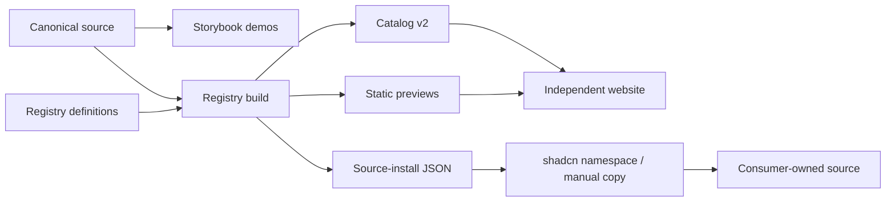

# Architecture and verification

Read [the glossary](../GLOSSARY.md) for domain terms and [ADR 0001](adr/0001-source-distribution-and-verification.md) for the recorded decisions. The [workflow decisions](ecosystem-review.md) explain authoring and verification choices.

## Current flow

Catalog v2 entries may carry `categories`, an array of category identifiers authored in each registry item's `meta.cavemio`. Current groups are `blocks`, `ai`, `interactions`, and `text`; overlapping membership is allowed. Missing categories default to an empty array for older registries. The website owns category labels and filter controls; membership and component inventory remain registry-owned. This additive metadata does not change primary source hashes.

The website reads HTTP artifacts. It does not import sibling source. Preview fixtures are separate from installable registry components. See [component development](component-development.md) for file ownership.

For native website demonstrations, the build publishes `public/previews/native.json`: the catalog-aligned entry/source graph, source digests, declared npm dependencies, scoped demo styles, font/lifecycle asset paths and digests, and an empty compatibility notices field. The website explicitly installs these HTTP artifacts at build time, adapts imports/assets and fixture-only landmarks, and generates lazy imports. Canonical reusable components remain unchanged. Storybook and the website share authored demo content; the website owns layout, modal integration, and shortcut ownership. The older `public/previews/command-palette-demo.tsx.txt` fixture remains available for the targeted search sync. These artifacts are separate from shadcn registry items and catalog hash semantics.

## Deepened verification modules

Shared palette and mode tokens are authored in `preview/theme.css`. Native bundles carry an optional `themeCss` field for the website's downloadable stylesheet, while native styles include the same definitions. Standalone frames accept validated theme messages without navigation. See [theming](theming.md) for ownership, custom palettes, and sandbox behavior.

**Source-install verification.** The command owns consumer creation, installation, preservation assertions, compilation, and cleanup. Each registry item has an isolated case through both the shadcn namespace and direct-URL paths; combined installation has its own case. This improves locality of fixture lifecycle and gives each new item leverage from the same verification interface. The interface is the test surface: actual installed files, CSS, dependencies, aliases, and a compiled usage example.

The previous sequential-only verification allowed Clarifying Question's helpers to satisfy later Response Versions assertions. Independent cases remove that ordering dependency. Examples in `scripts/install-examples.ts` intentionally exercise actual public props, including Request Lifecycle Preview, which previously was only imported.

The install-contract module also compiles registry items using only their shipped files and declared packages, with no sibling-source or workspace dependency resolution. It runs during registry validation and HTTP install preflight. Its negative tests establish that missing helpers and undeclared dependencies fail. This supplies local evidence when external downloads are unavailable; it does not replace actual consumer installation.

**Browser verification.** Playwright Test owns suite discovery, isolated contexts, Storybook lifecycle, timeouts, and diagnostics. The existing story adapters keep their actions and measured text/frame assertions local. One runner interface gives contributors leverage without a generic runtime motion adapter. Browser assertions must retain the ability to detect intermediate wrapping, clipped words, jumps, lost focus, and stale ghosts.

**Deletion test.** A forwarding module that merely moves calls adds little depth. These modules earn depth by owning isolation, lifecycle, and evidence: deleting them would redistribute those obligations across callers. Their internal implementation may evolve while the observable test interface stays stable.

Message Edit and Response Versions remain separate modules. Similar easing syntax does not justify a common seam when their content, width, height, and history responsibilities differ.

## Website contract and current gap

Read-only inspection of sibling `cavemio-web` on 16 October 2026 found these requirements in `src/lib/registry.ts` and `src/components/explorer.tsx`:

- Catalog version remains **2**. Item and preview paths are relative `./r/*.json` and `./previews/*.html` URLs.
- Item names, metadata, dependency arrays, and array order agree between catalog and source-install JSON.
- `sourceSha256` hashes `files[0].content`. It does **not** fingerprint the full registry item. The registry validator separately checks every built file against source; changing the hash meaning requires a coordinated web/catalog migration.
- Standalone previews support script-enabled sandboxed iframes for collection thumbnails and unsynced fallbacks. Website detail demos use the explicit build-time native source integration described above; the source explorer still displays installed source as text. Keep HTTP artifact consumption separate from sibling source imports.
- Official installer pin and namespace configuration remain compatible with documented commands.

The initial review found a hard-coded Switch selection and single-file explorer. A subsequent user-authorized follow-up in `cavemio-web` resolved that gap: catalog-driven collection/detail routes now support all current items, display every helper file, validate the selected bundle, and test exact contents and live previews against this registry. Catalog v2 and primary-file hash semantics remain unchanged. Website search consumes catalog metadata over HTTP and installs the Command Palette registry item as editable source. The palette is authored here; the website owns routing and commands. See that repository’s `docs/architecture.md` for its implementation and verification boundary.

## Review a future change

Before introducing a shared module, identify callers and what actually varies at the seam. One hypothetical adapter is insufficient evidence for new indirection. Describe how locality or leverage improves and which behavior tests survive. Check [decision records](adr/0001-source-distribution-and-verification.md) before revisiting established choices; document real new friction rather than proposing a generic rewrite.

The catalog includes documentation props for all current components. These rows describe the canonical public TypeScript APIs and are consumed by the website’s Overview/Props demo pages. Updating a public prop requires updating its registry documentation entry.
